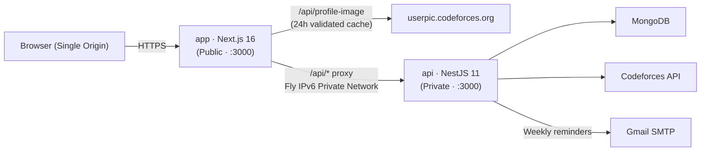

<div align="center">

<a href="https://upsolve-it.hnuicpc.tech">
  
</a>

# Upsolve It

**Make your next solve count. Competitive programming practice, with a plan.**

Timed problem sets built around your rating, an upsolve queue that keeps every problem you miss, weekly email reminders, and progress analytics — built for competitive programmers who want every attempt to pay off. Works with Codeforces today, and built so other platforms can follow.

[](https://upsolve-it.hnuicpc.tech)
[](https://github.com/Mohamediibra7im/upsolve-it/actions/workflows/ci.yml)


[Features](#features) · [Pages](#pages) · [Architecture](#architecture) · [Quick Start](#quick-start) · [Environment Variables](#environment-variables) · [API Overview](#api-overview) · [Deployment](#deployment--cicd) · [Contributing](#contributing)

</div>

---

## Why Upsolve It?

Most rating growth in competitive programming happens **after** the contest timer hits zero. Upsolve It connects deliberate practice with consistent follow-through:

1. **Train with structure** — generate problem sets tailored to your rating, target level, and weak topics.
2. **Never lose an unsolved problem** — automatically collect unsolved training problems and failed attempts from recent contests.
3. **Keep showing up** — sync solved status straight from your judge, get weekly email nudges for lingering problems, and track streaks and consistency over time.

> **Platforms:** Upsolve It works with **Codeforces** today: your handle, your rating, the problems, and the verdicts all come from there. More platforms are planned.

---

## Features

### Five Training Modes

| Mode | Set Size | Duration | Purpose |
| --- | --- | --- | --- |
| **Ladder** | 4 problems | 120 min | Climb across 110 progression levels (target ratings `900`–`4050` in 100-point bands) |
| **Weakness** | 4 problems | 120 min | Focus on algorithm tags where your session history shows room to grow |
| **Speed Round** | 4 problems | 52 min | Shorter set (`rating - 400` to `rating - 100`) to sharpen speed and clean implementation |
| **Contest** | 4 problems | 120 min | Contest simulation (`rating - 200` to `rating + 200`) with ratings and details hidden |
| **Endurance** | 6–8 problems | 180–240 min | Extended sets around your current rating to build stamina |

Pick a mode on the training page and its lane opens with everything it needs. Sessions support tag filtering, per-problem timers, live Codeforces submission polling, and post-session reviews.

### Automated Upsolve Queue & Codeforces Sync
- **Grouped by round**: The queue is organised by the session or contest each problem was missed in. Every round shows its problem set, what you solved, and what is still open, so you can finish what each round started.
- **Contest import**: Pulls problems you attempted and did not solve in recent Codeforces contests (90-day window across live, virtual, and out-of-competition participations, excluding gym contests).
- **One-click status refresh**: Checks your Codeforces submissions and marks tracked problems solved automatically once an `OK` verdict appears.
- **Persistent dismissals**: Removing a problem records it as dismissed so future syncs will not re-import it.

### Weekly Upsolve Email Reminders
- Opt-in verified email reminders, switched on from the upsolve page.
- An in-process hourly scheduler refreshes Codeforces submissions before emailing (so solved problems are never nagged about) and sends at most one digest per week.
- Confirmation and one-click unsubscribe links use signed JWT tokens handled at `/email`.

### Profiles
- **Your profile**: Display name, bio, links (GitHub, LinkedIn, website and more), and a generated avatar picked from [glyph-avatar](https://github.com/nilbuild/glyph-avatar) or your Codeforces photo. Account, email, privacy, and session controls live on a separate **Settings** page.
- **Public profile (`/u/<handle>`)**: Opt-in and only for verified handles. Shows your identity, rating, training stats, and a 53-week activity heatmap, with its own share image.

### Analytics, Streaks & Friends
- **Dashboard & Statistics**: Activity heatmap, training and upsolve streaks, 7-day consistency score, performance charts, per-mode breakdowns, session history, and weakness detection.
- **Friends**: Send, accept, decline, cancel, and remove friend requests, and view friends' training statistics.

### Security & Administration
- **Cookie-based JWT Auth**: HttpOnly access (`15m`) and rotating refresh (`7d`) cookies — tokens are never stored in `localStorage`.
- **Codeforces Ownership Verification**: Expiring verification codes placed in your Codeforces profile's *First name* field verify handle ownership and power password recovery.
- **Hardened HTTP Layer**: Helmet CSP, exact-origin CORS allowlist (no wildcard preview origins), global DTO whitelist validation, Zod startup env validation, and per-endpoint rate limiting (`X-RateLimit-*` & `Retry-After` headers).
- **Admin Console (`/admin`)**: User directory, role management, account lock/unlock, single & batch Codeforces profile sync, user stats inspection, and structured audit logs.
- **Announcements**: Admins write an announcement with an optional start and end time and a call to action; every live one takes its turn in a bar under the menu, for visitors, members, or both, and its title opens the whole message. Each change is audit-logged.

---

## Pages

| Area | Routes |
| --- | --- |
| **Public** | `/` landing, `/modes`, `/ladder`, `/how-it-works`, `/faq`, `/about`, `/contact`, `/u/<handle>`, `/privacy`, `/terms` |
| **Account** | `/login`, `/signup`, `/reset-password`, `/email` (reminder links) |
| **App** | `/dashboard`, `/training`, `/training/reviews`, `/upsolve`, `/statistics`, `/friends`, `/profile`, `/settings` |
| **Admin** | `/admin/dashboard`, `/admin/users`, `/admin/announcements`, `/admin/logs` |

Every public page has its own metadata and a generated share image (`opengraph-image.tsx`, one shared template in `frontend/lib/og.tsx`).

### Design System

The interface is one dark theme, "Track": a black ground, a single volt accent, uppercase condensed headings (Barlow Condensed), Barlow for text, and JetBrains Mono for numbers. Tokens and the `u-*` component classes live in [`frontend/app/globals.css`](frontend/app/globals.css); small React pieces are in [`frontend/components/ui/kit.tsx`](frontend/components/ui/kit.tsx). Navigation is a top bar on every screen, with a full-screen menu on phones.

---

## Architecture

Both apps live in one repository and ship in a **single Docker image** deployed to one Fly.io app (`upsolve-it`) with two process groups:



In production, the browser only talks to one origin. Next.js rewrites `/api/*` to the private `api` process (`API_INTERNAL_URL`), eliminating cross-origin browser requests while keeping the NestJS API off the public internet. Next.js's own `/api/profile-image` route takes precedence over the rewrite to validate and cache Codeforces avatars.

### Monorepo Layout

| Path | Description | Stack |
| --- | --- | --- |
| [`frontend/`](frontend/) | Web application (App Router, standalone output) | Next.js 16, React 19, TypeScript 5, Tailwind CSS 3 |
| [`backend/`](backend/) | REST API, Codeforces sync, & reminder scheduler | NestJS 11, TypeScript 5.9, MongoDB (Mongoose 9) |
| [`Dockerfile`](Dockerfile) | Multi-stage `node:24-slim` image containing both services | Docker |
| [`fly.toml`](fly.toml) | Dual-process (`app` + `api`) Fly.io deployment config | Fly.io |
| [`.github/workflows/ci.yml`](.github/workflows/ci.yml) | Parallel frontend/backend CI checks + auto-deploy on `main` | GitHub Actions |

<details>
<summary><strong>Explore directory structure</strong></summary>

```text
upsolve-it/
├── frontend/
│   ├── app/
│   │   ├── (marketing)/     # Landing, /modes, /ladder, /how-it-works, /faq, /about, /contact, /u/[handle], /email, /privacy, /terms
│   │   ├── (auth)/          # /login, /signup, /reset-password
│   │   ├── (main)/          # /dashboard, /training, /upsolve, /statistics, /friends, /profile, /settings
│   │   ├── admin/           # /admin/dashboard, /admin/users, /admin/announcements, /admin/logs
│   │   └── api/             # /api/profile-image avatar validation proxy
│   ├── components/          # Feature modules, shared widgets, layout shell, UI primitives
│   ├── hooks/               # SWR data, auth, training, social, and admin hooks
│   ├── services/            # Codeforces API helpers & training mode/rating calculations
│   ├── lib/                 # Cookie-aware API client, SEO metadata, share image template, utilities
│   └── vendor/braces/       # Security-hardened local backport of braces 3.0.3
├── backend/
│   └── src/
│       ├── config/          # Zod environment validation
│       ├── common/          # Auth/rate-limit guards, Helmet/CORS setup, filters, CF API client
│       └── modules/
│           ├── auth/            # JWT cookies, CF profile verification, password reset, profile editing
│           ├── trainings/       # Training sessions, reviews, streaks & weakness endpoints
│           ├── training-levels/ # 110 seeded canonical rating levels
│           ├── upsolve/         # Queue CRUD, CF contest import & solved-status sync
│           ├── reminders/       # Weekly digest scheduler & signed email links
│           ├── user-stats/      # Streaks, active days & 7-day consistency
│           ├── friends/         # Friend requests & friend stats
│           ├── public-profile/  # Opt-in public profiles for verified handles
│           ├── announcements/   # Admin-written announcements shown in a bar
│           ├── admin/           # User management, batch sync & platform metrics
│           ├── audit-logs/      # Administrative & security event trail
│           └── health/          # /api/health, /ready, /live probes
├── Dockerfile
├── fly.toml
└── .github/workflows/ci.yml
```

</details>

---

## Tech Stack

| Layer | Technologies |
| --- | --- |
| **Frontend** | Next.js 16 (App Router, Turbopack, standalone output), React 19, TypeScript 5, Tailwind CSS 3, Radix UI, SWR 2, Recharts 3, Lucide React, glyph-avatar |
| **Backend** | NestJS 11, TypeScript 5.9, Mongoose 9, `@nestjs/jwt`, Zod 4, `class-validator`, `nestjs-pino`, Helmet, `rate-limiter-flexible`, Nodemailer 10, Swagger |
| **Testing & Quality** | Jest 30, React Testing Library, Supertest, `mongodb-memory-server` (isolated replica set), ESLint 9, Prettier, `npm audit` |
| **Infrastructure** | Docker (`node:24-slim`), Fly.io (`cdg` region), GitHub Actions, Cloudflare Web Analytics |

---

## Quick Start

### Prerequisites
- **Node.js 24+** (matches CI and Docker; Node `22.12+` minimum for frontend test dependencies) and **npm**
- **MongoDB** (local instance or MongoDB Atlas)

### 1. Clone the repository

```bash
git clone https://github.com/Mohamediibra7im/upsolve-it.git
cd upsolve-it
```

### 2. Configure environment variables

Create `backend/.env` from [`backend/.env.example`](backend/.env.example).

> [!TIP]
> Both Next.js and `backend/.env.example` default to port `3000`. Run the backend on `PORT=5000` locally so the two dev servers do not collide, and use secrets of **at least 32 characters** for `JWT_SECRET` and `JWT_REFRESH_SECRET` (validated at startup by Zod).

```env
# backend/.env
PORT=5000
NODE_ENV=development
FRONTEND_ORIGIN=http://localhost:3000
MONGODB_URI_DEV=mongodb://localhost:27017/training-tracker-dev
JWT_SECRET=replace-with-a-random-string-at-least-32-chars
JWT_REFRESH_SECRET=replace-with-another-random-string-at-least-32-chars
```

Create `frontend/.env.local` (or `frontend/.env`) from [`frontend/.env.example`](frontend/.env.example):

```env
# frontend/.env.local
NEXT_PUBLIC_API_BASE_URL=http://localhost:5000
```

### 3. Install dependencies and start both services

In one terminal (backend):

```bash
cd backend && npm ci && npm run dev
```

In a second terminal (frontend):

```bash
cd frontend && npm ci && npm run dev
```

### 4. Open locally

| Service | URL |
| --- | --- |
| **Web App** | http://localhost:3000 |
| **REST API** | http://localhost:5000/api |
| **Swagger Docs** | http://localhost:5000/docs |

---

## Environment Variables

<details>
<summary><strong>Backend (<code>backend/.env</code>)</strong></summary>

| Variable | Required | Default | Description |
| --- | --- | --- | --- |
| `MONGODB_URI_DEV` / `MONGODB_URI_PROD` | One DB URI required | — | Environment-specific MongoDB URIs (`MONGODB_URI` / `MONGO_URL` work as fallbacks) |
| `JWT_SECRET` | Yes | — | Signing key for access tokens (minimum 32 characters) |
| `JWT_REFRESH_SECRET` | Yes | — | Signing key for refresh tokens (minimum 32 characters) |
| `PORT` | No | `3000` | Port the NestJS server binds to (on `::`) |
| `NODE_ENV` | No | `development` | `development`, `production`, or `test` |
| `FRONTEND_ORIGIN` | No | `http://localhost:3001` | Primary trusted frontend origin for CORS and email links |
| `APP_URL` | No | — | Public app base URL used in reminder email links (falls back to `FRONTEND_ORIGIN`) |
| `CORS_ORIGINS` | No | — | Comma-separated list of additional exact `http(s)://` origins |
| `JWT_EXPIRATION` / `JWT_REFRESH_EXPIRATION` | No | `15m` / `7d` | Token lifetimes |
| `SMTP_EMAIL` / `SMTP_PASSWORD` | No | — | Gmail SMTP credentials enabling weekly upsolve reminder emails |
| `SWAGGER_USER` / `SWAGGER_PASSWORD` | No | — | Optional HTTP Basic Auth credentials protecting `/docs` and `/docs-json` |
| `CODEFORCES_API_BASE` | No | `https://codeforces.com/api` | Codeforces API base URL |
| `CODEFORCES_API_KEY` / `CODEFORCES_API_SECRET` | No | — | Optional Codeforces API credentials |
| `LOG_LEVEL` | No | `info` | Pino log level (`fatal`, `error`, `warn`, `info`, `debug`, `trace`) |

</details>

<details>
<summary><strong>Frontend (<code>frontend/.env.local</code> / Docker build args)</strong></summary>

| Variable | Scope | Description |
| --- | --- | --- |
| `NEXT_PUBLIC_API_BASE_URL` | Client (build-time / dev) | Direct API origin for local dev (e.g. `http://localhost:5000`). Leave empty `""` in production so the browser calls `/api/*` on its own origin. |
| `API_INTERNAL_URL` | Server (build-time) | Private backend origin for Next.js `/api/*` rewrites in production (e.g. `http://api.process.upsolve-it.internal:3000`). Leave unset locally. |

</details>

---

## API Overview

All API endpoints are served under `/api`, and interactive OpenAPI documentation is available at `/docs`.

| Prefix | Responsibilities |
| --- | --- |
| `/api/auth` | Registration, login, refresh token rotation, logout, Codeforces profile sync & verification, password reset |
| `/api/trainings` | Historical training CRUD |
| `/api/training-sessions` | Active session creation, problem timers, live Codeforces sync, session completion & reviews |
| `/api/levels` | 110 seeded canonical training levels |
| `/api/upsolve` | Upsolve list CRUD, dismissal tracking & Codeforces contest/status sync (`POST /api/upsolve/sync`) |
| `/api/reminders` | Weekly email subscription status, opt-in/out & signed link redemption (`POST /api/reminders/redeem`) |
| `/api/users/me/*` | Streaks & consistency (`/streaks`), weak-topic analysis (`/weaknesses`) and profile editing (`PATCH /profile`) |
| `/api/public-profile` | Public profile by handle (opt-in, verified handles only) and your own visibility setting |
| `/api/announcements` | The announcements currently on show (`GET /current`) |
| `/api/friends` | Friend requests lifecycle, friend list & friend statistics |
| `/api/admin` | Platform stats, user search/roles/lock/unlock, batch CF sync, announcements & audit logs |
| `/api/health` | Liveness (`/live`), readiness (`/ready`) & combined health checks (exempt from rate limits) |

---

## Scripts & Testing

### Frontend (`cd frontend`)

| Command | Purpose |
| --- | --- |
| `npm run dev` | Start Next.js dev server on port `3000` |
| `npm run build` | Build production standalone bundle |
| `npm run lint` | Run ESLint (`--max-warnings=0`) |
| `npm test` | Run local dependency security tests (`vendor/braces`) + Jest / RTL suite |
| `npm run test:coverage` | Run Jest with coverage report |
| `npx tsc --noEmit --incremental false` | Strict TypeScript check |

### Backend (`cd backend`)

| Command | Purpose |
| --- | --- |
| `npm run dev` | Start NestJS in watch mode |
| `npm run build` | Compile TypeScript to `dist/` |
| `npm run prod` | Run compiled production server (`node dist/main`) |
| `npm run lint` | Run ESLint (`--max-warnings=0`) |
| `npm run typecheck` | Type-check all entrypoints via `tsconfig.check.json` |
| `npm test -- --runInBand` | Run unit tests |
| `npm run test:e2e -- --runInBand` | Run isolated E2E tests against a disposable `mongodb-memory-server` replica set |

> [!NOTE]
> Backend E2E tests spin up an isolated in-memory MongoDB replica set and never connect to your development or production database.

---

## Deployment & CI/CD

### Fly.io Single-Image Setup

Configured in [`Dockerfile`](Dockerfile) and [`fly.toml`](fly.toml) for the `upsolve-it` Fly app (`cdg` primary region):

| Process Group | Command | Exposure | Health Check |
| --- | --- | --- | --- |
| `app` | `node frontend/server.js` | Public HTTPS (min 3 machines) | `GET /` every 30s |
| `api` | `node backend/dist/main` | Private IPv6 network only (`api.process.upsolve-it.internal:3000`) | `GET /api/health/live` every 15s |

Because `api` has no public service, Fly keeps it running continuously — ensuring the in-process weekly reminder scheduler stays active.

### GitHub Actions Pipeline

[`.github/workflows/ci.yml`](.github/workflows/ci.yml) runs on every pull request and push to `main`:

1. **`frontend` job** — `npm ci`, `npm audit --audit-level=moderate`, `npm run lint`, `npm test -- --runInBand`, `tsc --noEmit`, and `npm run build`.
2. **`backend` job** — `npm ci`, `npm run lint`, `npm test -- --runInBand`, `npm run test:e2e -- --runInBand`, `npm run typecheck`, `npm audit --audit-level=moderate`, and `npm run build`.
3. **`deploy` job** — On pushes to `main`, runs `flyctl deploy --remote-only` using the `FLY_API_TOKEN` repository secret once both jobs pass.

---

## Contributing

Contributions, bug reports, and feature ideas are welcome!

1. Fork the repository and create a branch from `main`.
2. Make your changes and verify both workspaces pass the CI checks:
   ```bash
   # Frontend checks
   cd frontend && npm run lint && npm test -- --runInBand && npx tsc --noEmit --incremental false && npm run build

   # Backend checks
   cd backend && npm run lint && npm test -- --runInBand && npm run test:e2e -- --runInBand && npm run typecheck && npm run build
   ```
3. Open a pull request against `main`, or [open an issue](https://github.com/Mohamediibra7im/upsolve-it/issues) to report a bug or propose an improvement.

---

## Community & Credits

Built under the **[HNU - FCSIT ICPC Community](https://hnuicpc.tech)** by **[Mohamed Ibrahim](https://mohamediibrahim.dev/)**.

- **Live App**: [upsolve-it.hnuicpc.tech](https://upsolve-it.hnuicpc.tech)
- **Issues & Feedback**: [GitHub Issues](https://github.com/Mohamediibra7im/upsolve-it/issues)
- **License**: The frontend package includes an MIT license at [`frontend/LICENSE`](frontend/LICENSE); the monorepo root does not currently define a top-level license file.
